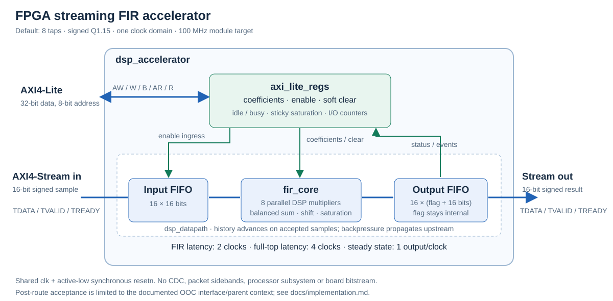
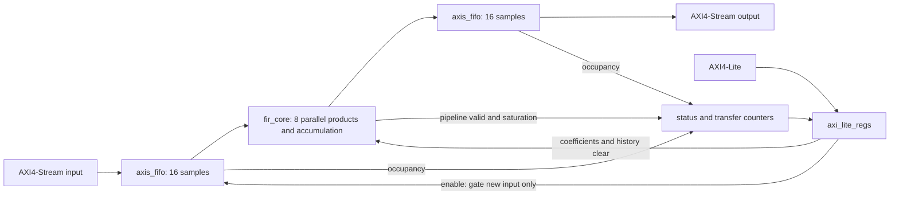

# First-Version Architecture and Module Contracts

Status: architecture contract for the initial RTL implementation. The Python
arithmetic model and vector generator exist. The parameterized Verilog `axis_fifo`
has passed directed/randomized simulation across five configurations and
out-of-context synthesis for the default configuration. The parameterized FIR,
idle/history-clear control and per-output clipping status pass 38 simulation
runs with independent Python comparison. Default standalone synthesis and a
measured adder-tree timing optimization are complete. Buffered FIFO/FIR integration
also passes end-to-end simulation and internal synthesis timing checks. The
AXI4-Lite register bank passes standalone protocol/register tests and synthesis.
The complete accelerator top passes AXI-controlled streaming regression and
100 MHz module-level post-route checks under its documented interface/parent
context. A [controlled full-top physical comparison](optimization_comparison.md)
also records the linear baseline versus balanced tree under identical constraints.
See [implementation results and limitations](implementation.md), [FIFO results](axis_fifo.md),
[FIR verification](fir_verification.md), [buffered datapath](datapath.md) and
[register-bank verification](axi_lite_regs.md) and [complete accelerator](accelerator.md).
Current results are in [readme.md](../readme.md); detailed original requirements
are preserved in the [archived proposal](proposal.md).

## Shared Timing Rules

All modules use `clk` and an active-low synchronous `resetn`. External reset
deassertion is assumed synchronous to `clk`. Hardware reset takes precedence over
transfers and configuration. Ready/valid transfers occur only on rising edges
outside reset. Sources must hold payload and valid until acceptance.

Backpressure must propagate through the FIFOs and core without changing a pending
output. The core may initially stall its complete pipeline together to simplify
correctness. A later optimization may change pipeline placement while preserving
sample order and arithmetic.

## Modules and Target Contracts

| Module | Main signals | Contract |
| --- | --- | --- |
| `axis_fifo` | `s_data`, `s_valid`, `s_ready`, `m_data`, `m_valid`, `m_ready`, `occupancy` | Implemented: parameterized width and power-of-two depth (at least 2), default 16 bits / 16 entries; combinational head read, no empty bypass; full FIFO rejects a write even during a same-cycle read |
| `fir_core` | Ready/valid data, packed parameter-width coefficients, `history_clear`, `idle`, `m_saturated` | Implemented and verified: parameterized signed arithmetic, idle-only history clear, no FIR-tail flush, one output per accepted sample; saturation travels with its output |
| `dsp_datapath` | External ready/valid data, direct coefficients/enable/clear, global idle, FIFO occupancy, clipping metadata/event | Implemented: input FIFO + FIR + output FIFO; disable gates external acceptance only; history clear requires disabled global idle |
| `axi_lite_regs` | Five AXI4-Lite channels, control/coefficients, status/counters | Implemented: independent AW/W capture, one write/read outstanding, byte strobes, decoded map/errors, counter and sticky state, commit-edge clear outputs |
| `dsp_accelerator` | External stream and AXI4-Lite ports, `clk`, `resetn` | Implemented: instantiates datapath and registers; connects global idle, control and qualified external-transfer/production-clipping events |

The implemented `dsp_datapath` owns the two FIFO instances, FIR instance, external
input enable gate and global history-clear qualification. The implemented
`dsp_accelerator` instantiates this block and `axi_lite_regs`. The register
bank owns coefficient, enable, counter and sticky-status state; the top
qualifies its event inputs and connects control/status signals. Direct coefficients
remain external inputs when testing the datapath separately.

The core registers products, adds them with a full-width balanced fabric adder
tree, then shifts/saturates into the output register. Its coefficient array is
supplied by `axi_lite_regs` in the complete top. Register access rules keep coefficients constant while
data is in flight. A successful coefficient update emits `history_clear` when
the complete accelerator is disabled and empty. `history_clear` is also emitted
by a legal soft-clear command.

At the `fir_core` interface, `history_clear` suppresses core input readiness.
The wrapper qualifies this request with disabled global idle, so busy/enabled
datapath clear pulses are ignored and internal drain remains active. A request
held while disabled clears history after both FIFOs and the core have drained.
The output FIFO stores `OUTPUT_WIDTH + 1` payload bits for
`{m_saturated, m_data}`.

`idle` for each FIFO means zero occupancy. Core `idle` means all valid stages are
empty. Global `IDLE` is the conjunction of these conditions. History contents do
not affect idle status. The saturation flag travels with its output data through
the core; sticky `SATURATED` is set when the result transfers into the output
FIFO. This event occurs exactly once per generated result, including under stalls.

Clearing `ENABLE` gates external input acceptance from the following cycle and
leaves all internal drain paths active. The top sends external input and
output handshakes to the register counters, not cycles with valid asserted. A scoreboard tracks queued
expectations across all internal buffering.

## Reference Model Boundary

`FirModel.process(sample)` represents one accepted sample, regardless of cycle
gaps. It accepts signed Python integers. `decode_signed` and `encode_signed`
convert bus words at file/monitor boundaries. The model uses exact integer
products and accumulation, floor shifting and final saturation.

`write_coefficient` represents an already-authorized effective coefficient
update and clears history. `clear_history` represents a legal soft clear, and
`hardware_reset` clears both coefficients and history. The model intentionally
does not enforce AXI state, enable, register strobes or FIFO capacity. Those are
separate RTL control and scoreboard checks.

Each generated vector scenario starts with hardware reset, programming all eight
coefficients, then a sequence of accepted input samples. The RTL driver must
advance its input file index only on a handshake and keep data stable during
stalls. The monitor consumes one expected word per output handshake. At scenario
end, the driver disables new inputs, holds output ready, and checks that every
expected result has drained before resetting for the next scenario.

## Remaining Delivery and Optional Implementation Work

1. Finalize presentation materials and repository delivery; the physical optimization comparison is complete.
2. Optionally reduce hold-closure resource cost without changing numerical behavior, latency or interface budgets.
3. Revalidate the retained OOC tool warning and constraints if reused in a different parent context.

FIFO simulation uses the installed Vivado 2026.1 simulator; see
[development instructions](development.md) for results and reproduction commands.
FIFO, FIR, buffered-datapath, register-bank and complete-top OOC synthesis are complete.
Complete-top module placement/routing passes under the documented context; a
different parent or board requires new acceptance. Python tests validate the reference flow and do not
establish RTL or timing acceptance.
