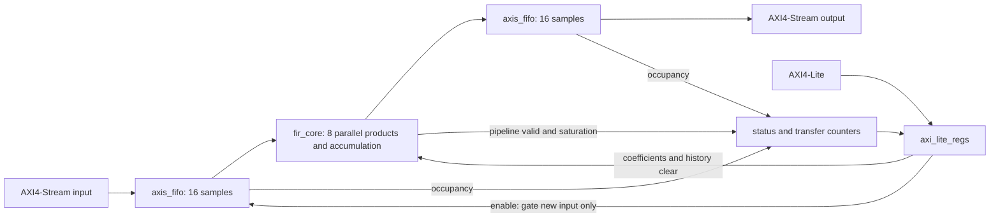

# First-Version Architecture and Module Contracts

Status: architecture contract for the initial RTL implementation. The Python
arithmetic model and vector generator exist; the RTL modules below are planned.
The proposal and register map are in [readme.md](../readme.md).

## Shared Timing Rules

All modules use `clk` and an active-low synchronous `resetn`. External reset
deassertion is assumed synchronous to `clk`. Hardware reset takes precedence over
transfers and configuration. Ready/valid transfers occur only on rising edges
outside reset. Sources must hold payload and valid until acceptance.

Backpressure must propagate through the FIFOs and core without changing a pending
output. The core may initially stall its complete pipeline together to simplify
correctness. A later optimization may change pipeline placement while preserving
sample order and arithmetic.

## Planned Modules

| Module | Main signals | Contract |
| --- | --- | --- |
| `axis_fifo` | `s_data`, `s_valid`, `s_ready`, `m_data`, `m_valid`, `m_ready`, `occupancy` | Parameterized width and power-of-two depth; no empty bypass; full FIFO may conservatively reject writes until the following cycle |
| `fir_core` | Input/output ready/valid data, coefficient array, `history_clear`, `idle`, result saturation flag | History advances only on accepted core inputs; no FIR-tail flush; one output per accepted sample |
| `axi_lite_regs` | Five AXI4-Lite channels, control/coefficients, status/counters | Independent write-address/data capture, one write and one read outstanding, decoded register map and error responses |
| `dsp_accelerator` | External stream and AXI4-Lite ports, `clk`, `resetn` | Instantiates buffers, core and registers; owns input gating, global idle and transfer counters |

The baseline core will register products and then register their full-width sum,
shifted and saturated into the output format. Its coefficient array is supplied
by `axi_lite_regs`. Top-level logic guarantees coefficients remain constant while
data is in flight. A successful coefficient update emits `history_clear` when
the complete accelerator is disabled and empty. `history_clear` is also emitted
by a legal soft-clear command.

`idle` for each FIFO means zero occupancy. Core `idle` means all valid stages are
empty. Global `IDLE` is the conjunction of these conditions. History contents do
not affect idle status. The saturation flag travels with its output data through
the core; sticky `SATURATED` is set when the result transfers into the output
FIFO. This event occurs exactly once per generated result, including under stalls.

Clearing `ENABLE` gates external input acceptance from the following cycle and
leaves all internal drain paths active. The top level counts external input and
output handshakes, not cycles with valid asserted. A scoreboard tracks queued
expectations across all internal buffering.

## Reference Model Boundary

`FirModel.process(sample)` represents one accepted sample, regardless of cycle
gaps. It accepts signed Python integers. `decode_signed` and `encode_signed`
convert bus words at file/monitor boundaries. The model uses exact integer
products and accumulation, floor shifting and final saturation.

`write_coefficient` represents an already-authorized effective coefficient
update and clears history. `clear_history` represents a legal soft clear, and
`hardware_reset` clears both coefficients and history. The model intentionally
does not enforce AXI state, enable, register strobes or FIFO capacity. Those are
separate RTL control and scoreboard checks.

Each generated vector scenario starts with hardware reset, programming all eight
coefficients, then a sequence of accepted input samples. The RTL driver must
advance its input file index only on a handshake and keep data stable during
stalls. The monitor consumes one expected word per output handshake. At scenario
end, the driver disables new inputs, holds output ready, and checks that every
expected result has drained before resetting for the next scenario.

## Next Implementation Milestone

1. Implement and simulate `axis_fifo` at depths 2, 4 and 16, including wraparound,
   boundary reads/writes, simultaneous transfers and reset.
2. Implement `fir_core` and compare directed vectors against the Python files.
3. Connect both FIFOs and stress the streaming datapath with stalls.
4. Add AXI4-Lite control after the streaming datapath is verified.

RTL simulation and early synthesis require a working HDL simulator and Vivado
installation. No RTL or timing acceptance is claimed by the Python tests.
