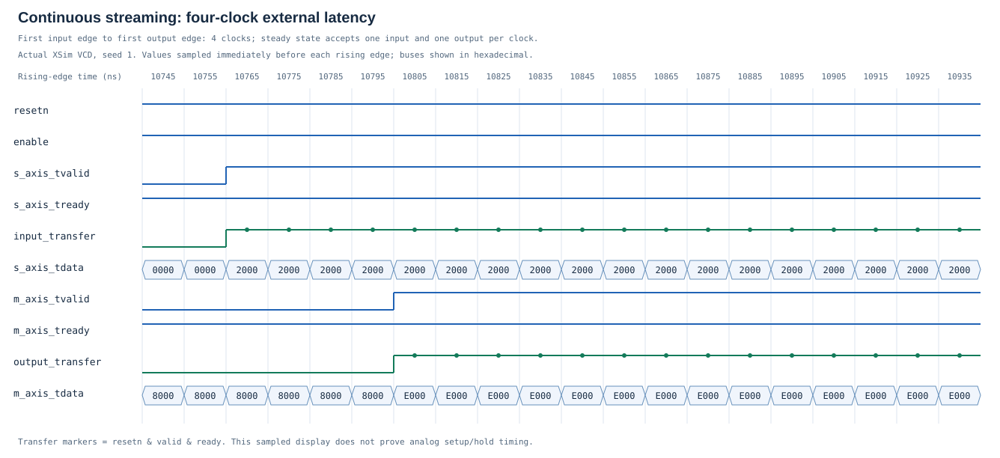
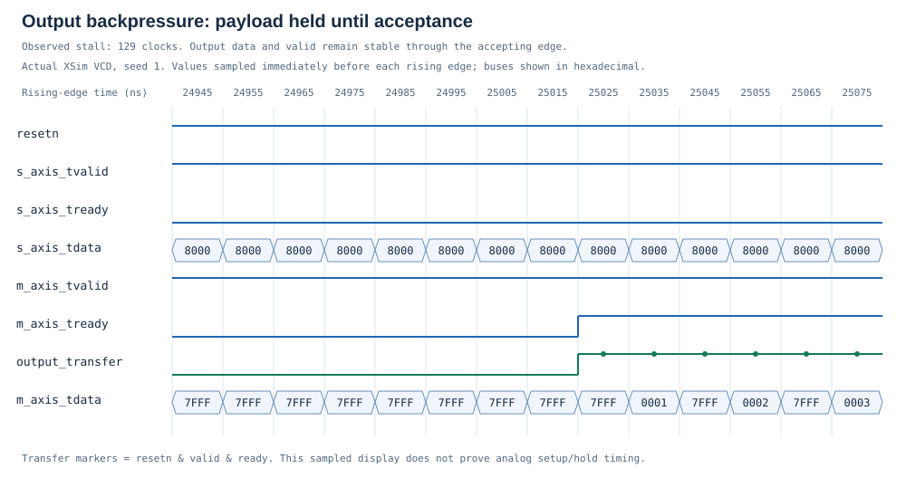
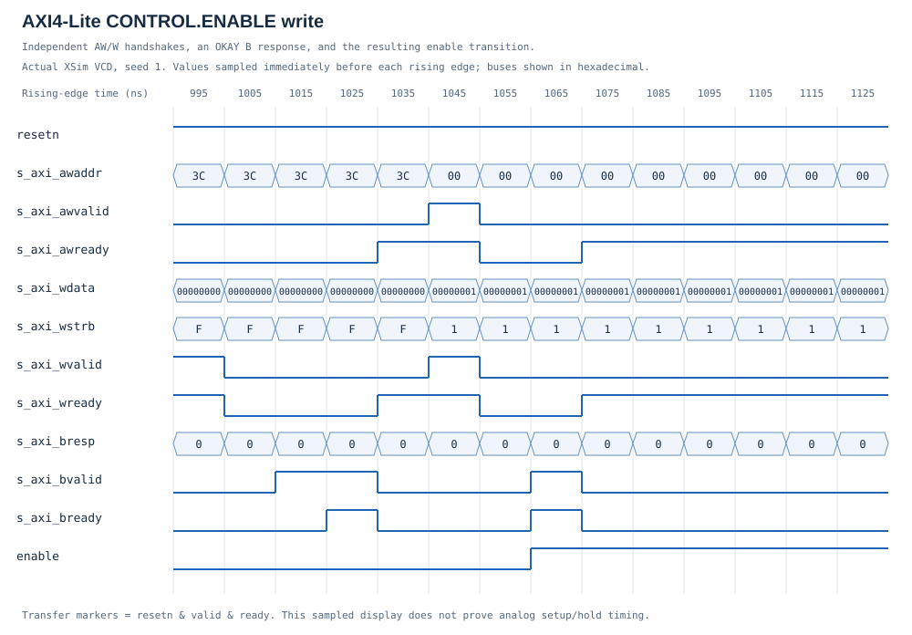

# Simulation Waveform Evidence

These figures come from a real XSim behavioral simulation of the unchanged
`tb_dsp_accelerator`, default hardware parameters, `SEED=1`, `SAMPLES=1000`.
The supplemental run accepted 2,282 inputs; all 2,180 completed outputs and
saturation flags matched Python, with 102 deliberately reset-discarded samples.
It is separate from the 47-run integrated acceptance total.

## Reading the Figures

Values are sampled immediately **before each rising edge**. This agrees with
the testbench's acceptance condition `resetn && valid && ready`; sampling after
register updates would give misleading handshake and latency measurements.
Column labels are actual rising-edge times in ns. Buses are hexadecimal, and
green markers identify accepted stream transfers.

These are discrete sampled waveforms rendered from a VCD, not Vivado GUI
screenshots. Intra-cycle glitches and analog setup/hold are outside the display;
physical timing is established separately by the implementation reports.



The first accepted input is followed by its first output four clocks later.
During steady state, an input and an output transfer on every clock. The
extraction script checks these conditions against the captured values.



The selected stall lasts at least eight clocks. `m_axis_tvalid` and output data
remain stable throughout the stall and through the first accepting edge. Input
readiness can fall as buffered capacity fills; valid alone is not a transfer.



The control example shows AW and W acceptance, `WSTRB`, an `OKAY` B response,
and the resulting `enable` transition. The register model and existing assertions
continue checking the complete run while these signals are captured.

## Reproduce and Inspect

```powershell
powershell.exe -NoProfile -ExecutionPolicy Bypass -File ./scripts/run_waveforms.ps1 -VivadoBin 'E:/2026.1/Vivado/bin' -Python 'H:/2025.1/tps/win64/python-3.13.0/python.exe'
```

The runner compiles into `build/waveforms/`, leaving the regular regression
snapshots and RTL untouched. The generated `accelerator.vcd`, simulator database,
accepted-event trace and logs stay there. Open the VCD in a compatible waveform
viewer, or use Vivado's behavioral simulation to inspect the same signals.
The immutable delivery archive also retains the clean run's
[raw VCD](../reports/delivery/v1.0.0/waveforms/accelerator.vcd) and
[accepted-event trace](../reports/delivery/v1.0.0/waveforms/waveform.events.txt),
so the recorded example can be inspected without rerunning Vivado.

The capture follows AMD's documented `open_vcd`, `log_vcd` and `close_vcd`
workflow; see [UG900 VCD guidance](https://docs.amd.com/r/2024.1-English/ug900-vivado-logic-simulation/Using-the-Value-Change-Dump-Feature)
and [UG835 log_vcd](https://docs.amd.com/r/2026.1-English/ug835-vivado-tcl-commands/log_vcd).
The local Tcl filename avoids XSim's handling of spaces in batch-script paths.

[render_waveforms.py](../scripts/render_waveforms.py) parses the captured VCD,
checks its 10 ns clock, selects verified examples, and writes the SVG files.
[Summary and hashes](../reports/waveforms/summary.json),
[sampled values](../reports/waveforms/sampled_windows.json),
[simulator log](../reports/waveforms/simulation_log.txt), and
[Python comparison](../reports/waveforms/python_comparison.json) are retained.
No image-generation model or manually supplied data is used in these plots.
