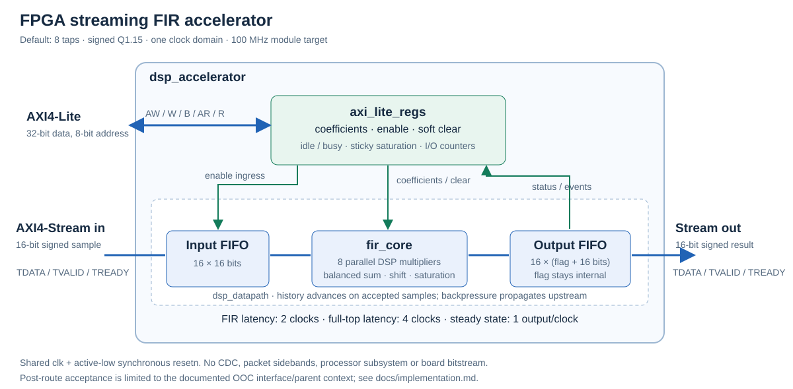
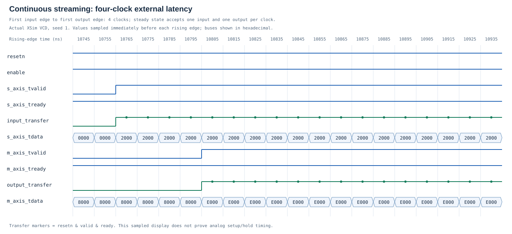

# FPGA AXI-Stream FIR Accelerator

A parameterized streaming FIR accelerator with **Verilog RTL**, an **AXI4-Lite
control plane**, self-checking **SystemVerilog verification**, and an integer
**Python reference model**. The complete top is `dsp_accelerator`.

The default eight-tap build sustains one output per clock with four-clock
external latency. Its routed OOC module meets the declared 100 MHz interface
and parent-context constraints. No physical board is required for this project.

**v1.0.0 delivery:** a clean Git export passed **27 Python tests and 285 HDL
simulations**, including both physical builds. See the
[frozen acceptance report](reports/delivery/v1.0.0/release/summary.json) and
[delivery evidence index](reports/delivery/v1.0.0/README.md).



## Measured results

Vivado 2026.1 build 6511674, Artix-7 `xc7a35tcpg236-1`, 10 ns clock.
The comparison uses the complete top, identical interface/physical constraints,
and the same adaptive hold-repair policy. Both variants passed the same 47-run
integrated regression; all 47 accepted-event traces are byte-identical.

| Post-route metric | Linear-sum baseline | Balanced-tree FIR |
| --- | ---: | ---: |
| Setup WNS / TNS | -5.595 / -435.890 ns | +0.273 / 0 ns |
| Worst hold slack | +0.034 ns | +0.031 ns |
| 100 MHz module timing | Fails setup | Passes setup and hold |
| LUT / slice FF | 724 / 383 | 1,043 / 463 |
| DSP / BRAM | 8 / 0 | 8 / 0 |
| Core / full-top latency, no stalls | 2 / 4 clocks | 2 / 4 clocks |
| Functional throughput, no stalls | 1 output/clock | 1 output/clock |

The balanced fabric tree improves setup slack by **5.868 ns**, trading
**319 LUTs (+44.1%)** and **80 slice FFs** for timing closure without an added
pipeline cycle. Totals include 709 baseline versus 722 optimized hold-repair
LUT1 cells. Baseline throughput in simulation does not establish 100 MHz
operation, because that build fails physical setup timing.

Each integrated suite includes 227,000 accepted random inputs plus directed
traffic: **281,842 completed outputs and clipping flags match Python exactly**.
The 2,958 deliberately reset-discarded inputs are accounted separately. Every
run demonstrates at least 1,050 consecutive output transfers.

See the [physical comparison](docs/optimization_comparison.md),
[complete-top verification](docs/accelerator.md), and
[machine-readable results](reports/implementation_comparison/summary.json).

## Design contract

- Default: eight parallel multipliers, signed 16-bit Q1.15 samples and
  coefficients, 16-bit output, 16-entry input and output FIFOs.
- Full 32-bit products and a 35-bit sum; arithmetic right shift by 15 rounds
  toward negative infinity, followed by signed output saturation.
- AXI4-Stream subset: `TDATA`, `TVALID`, `TREADY`. A transfer occurs only when
  valid and ready are both high on a rising edge. No packet sidebands or CDC.
- Backpressure preserves unconsumed payloads; sample history advances only for
  accepted samples. Input gaps do not insert zero samples or flush a FIR tail.
- Coefficient writes and soft clear require disabled and globally idle state.
  Disable stops new ingress while accepted data drains. Soft clear
  preserves coefficients and clears history, counters and sticky clipping.
- One clock domain and an active-low **synchronous** reset. Hardware reset
  discards pending transactions and resets coefficients and processing state.

Widths, binary points, tap count and FIFO depths are compile-time parameters.
The documented acceptance matrix covers the required build and selected smoke
configurations, rather than every possible parameter combination.

| AXI4-Lite byte offset | Register | Meaning |
| --- | --- | --- |
| `0x00` | `CONTROL` | Bit 0 enable, bit 1 soft-clear command |
| `0x04` | `STATUS` | Idle, busy and sticky saturation |
| `0x08` / `0x0C` | Input / output counts | Accepted stream transfers, modulo 2^32 |
| `0x20 + 4*k` | `COEFF[k]` | Signed coefficient; writes require disabled + idle |

Independent AW/W arrival, response backpressure, byte strobes and invalid-access
`SLVERR` behavior are verified. See the [full register contract](docs/axi_lite_regs.md)
and [architecture](docs/architecture.md).

## Actual simulation waveforms

The images below are sampled from a real XSim VCD using the unchanged full-top
testbench, not manually constructed stimulus illustrations. Values are taken
immediately **before each rising edge**, matching handshake acceptance.



[Output backpressure](docs/assets/waveform_backpressure.svg) and
[AXI4-Lite enable write](docs/assets/waveform_axi_enable.svg) show payload
stability and control transactions. See [waveform provenance and reproduction](docs/waveforms.md).

## Reproduce

Tested on Windows with Vivado 2026.1, device support for `xc7a35tcpg236-1`,
Windows PowerShell and Python 3.10+ (tested: 3.13.0). Python needs no third-party
packages. Adapt executable locations to your installation; the examples use
the validated development-machine paths.

Python-only checks:

```powershell
python -m unittest discover -s tests -v
python scripts/generate_vectors.py --seed 1 --count 10000
```

Complete acceptance: reference tests, all module suites, integrated regression,
both physical comparison builds, and waveform capture:

```powershell
powershell.exe -NoProfile -ExecutionPolicy Bypass -File ./scripts/run_release.ps1 -VivadoBin 'E:/2026.1/Vivado/bin' -Python 'H:/2025.1/tps/win64/python-3.13.0/python.exe'
```

The process-only execution policy leaves persistent policy settings unchanged.
Generated simulator databases, vectors, VCDs and checkpoints stay in `build/`.
A failed step stops the flow; the final verifier checks source hashes, run
counts, timing coverage, routing audits and waveform evidence before publishing
`reports/release/summary.json`. The baseline's setup failure remains explicit.

For a shorter integrated-only run:

```powershell
powershell.exe -NoProfile -ExecutionPolicy Bypass -File ./scripts/run_accelerator.ps1 -VivadoBin 'E:/2026.1/Vivado/bin' -Python 'H:/2025.1/tps/win64/python-3.13.0/python.exe'
```

[Development instructions](docs/development.md) cover individual suites,
Vivado GUI setup, implementation and verification-only commands.
[Delivery notes](docs/delivery.md) describe the clean-export acceptance procedure.

## Evidence and source map

| Area | Source / report |
| --- | --- |
| RTL | [Five Verilog modules](fpga_streaming_dsp/fpga_streaming_dsp.srcs/sources_1/new) |
| Verification | [SystemVerilog benches](fpga_streaming_dsp/fpga_streaming_dsp.srcs/sim_1), [Python model](model/fir.py), [model/vector tests](tests) |
| Automation | [Regression and implementation scripts](scripts), [XDC constraints](constraints) |
| Module evidence | [FIFO](docs/axis_fifo.md), [FIR](docs/fir_verification.md), [buffered datapath](docs/datapath.md), [AXI4-Lite](docs/axi_lite_regs.md) |
| Physical evidence | [Scope and warnings](docs/implementation.md), [comparison reports and frozen sources](reports/implementation_comparison) |
| Detailed requirements | [Archived proposal and specification](docs/proposal.md) |

## Acceptance boundaries

The implementation is a routed **OOC module**, using declared integration
budgets: inputs arrive 0.5?2.0 ns after launch; the receiver reserves 2.0 ns setup
and 0.5 ns hold. These are assumptions, not measured board delays.

All 115 functional interfaces reach their assigned physical partition nodes;
missing clocks/I/O delays, unconstrained internal endpoints and unexpected
internal route errors are zero. Parent-side boundary nets are intentionally
absent, so raw whole-design routing remains partially routed at those boundaries.
`Constraints 18-8777` remains an unresolved tool/context warning and is retained
in the reports. Integration into a parent design requires new acceptance.

No board bitstream, physical-board validation, assembled-parent signoff,
gate-level timing simulation, formal proof or measured Fmax is claimed.
